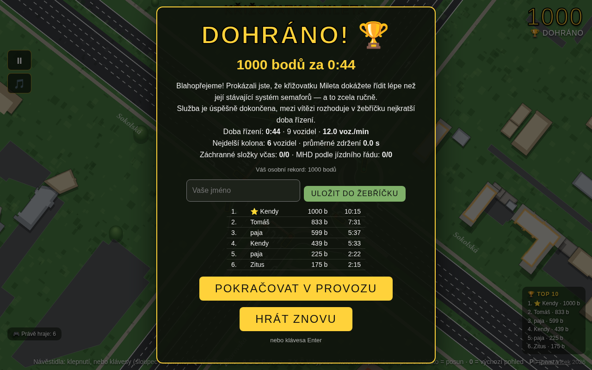

# 🚦 KŘIŽOVATKA MILETA

Prohlížečová hra o ručním řízení semaforů na skutečné křižovatce **Mileta** v Hradci Králové (Hradecká × Sokolská × Zborovská, u Fakultní nemocnice). Top-down pohled ve stylu GTA 2, čistý HTML5 canvas bez jediné závislosti.

**▶ Hraje se na https://izovan.cz/mileta/**



## O co jde

Převezmete řízení všech semaforů křižovatky. Auta přijíždějí ze čtyř ramen, vy přepínáte jednotlivá návěstidla a snažíte se propustit co nejvíc vozidel, aniž by se něco srazilo. **Nikdo nikomu nedává přednost** — levá odbočení kříží protisměr naslepo, pravé bypassy se vlévají do hlavního proudu naslepo. Jediná ochrana je ve vašich rukou: pouštět jen směry, které se nekříží (chráněné fáze), a hlídat mezičasy.

- **Bouračka = okamžitý konec** (s replayem nehody a rozborem).
- **0 bodů = konec** — body ubývají za nestíhané mise a hladovějící směry.
- **1000 bodů = dohráno** 🏆 — pak lze pokračovat v provozu jen tak pro radost.

## Ovládání

Sloupec = rameno křižovatky, řádek = pohyb:

| Pohyb | Hradecká | Sokolská (V) | Zborovská | Sokolská (Z, od FN) |
|---|---|---|---|---|
| Rovně | **Q** (1) | **W** (2) | **E** (3) | **R** (4) |
| Vlevo | **A** | **S** | **D** | **F** |
| Bypass vpravo | **Z** (Y) | **X** | **C** | **V** |

Dále: klik/tap na semafor přepíná, **P** pauza, **M** hudba, kolečko/pinch zoom, pravé tlačítko/drag posun kamery, **0** reset kamery. Plná podpora mobilu (tap/drag/pinch, responzivní HUD).

## Herní mechaniky

- **Doprava dle reality**: hlavní tah je Sokolská V↔Z, ranní/odpolední špičky, vlny provozu, déšť (snížená adheze → delší brzdné dráhy). Osobáky, **osobáky s přívěsným vozíkem**, motorky, dodávky, pevné nákladní vozy, **cisterny, popelářské vozy, odtahovky**, **tahače s návěsem**, vzácné pomalé **traktory s valníkem plným balíků slámy**, autobusy, **kloubové autobusy** a trolejbusy. Dvoudílné soupravy mají samostatnou fyziku a kolizi každého článku; vozidla odbočující vlevo nebo vpravo používají animované blinkry.
- **Mise IZS**: sanitka/policie/hasiči se sirénou a pulzujícím halo — propusťte do 25 s (+10 / −60). Vzácně **hromadný výjezd IZS**: tři vozidla ze tří směrů na jeden výjezd, jejich trasy se vzájemně kříží — nutno pouštět postupně (do 60 s, +10 za vozidlo +20 bonus / −60 za každé nestihnuté).
- **Mise MHD**: červené busy a trolejbusy s číslem linky jedou podle jízdního řádu — 45 s na průjezd (+5 / −30). Mise mohou jet rovně, vlevo i vpravo bypassem.
- **Žádný směr nelze obětovat**: každé rameno má virtuální frontu poptávky „za mapou" a vozidlo stojící přes 80 s začne stát body (−3 každých 5 s). Mise jsou připnuté na vylosované rameno a ucpaný nájezd je nezachrání.
- **Mezičas (straggler-hold)**: na zelenou se nevjíždí, dokud křižovatku dojíždí vozidlo z kolmého směru — jediná automatika, která hráče jistí.
- **Výstrahy**: kolizní kombinace zelených blikají oranžově; při koloně 10+ aut řidiči troubí; HUD „semafor průtoku" hlásí plynulost/zácpu; náhodné reakční doby řidičů rozjíždějí kolony kaskádově.
- **Po nehodě replay** (zpomalený záznam ~3 s před nárazem), na konci statistiky: propuštěná vozidla, nejdelší kolona, průměrné zdržení, úspěšnost misí.

## Věrnost předloze

- Geometrie po rekonstrukci 2023–25: na každém rameni levý řadicí pruh + 2 přímé + pravý bypass kolem ostrůvku, podchody místo přechodů, zúžené výjezdy (Hradecká na 1 pruh), Zborovská se dvěma levými řadicími pruhy.
- Okolní zástavba je **reálná z OpenStreetMap** (`buildings.js` — generováno skriptem z OSM exportu, střed 50.201147 N 15.832446 E, budovy stylované podle typu a podlažnosti, areál FN).
- Scéna otočená o 38° jako na leteckém snímku.

## Zvuk

Web Audio API: klaksony (reálné samply, různé pro kamiony), siréna, pískot brzd, motor, obláčky kouře při rozjezdu (trolejbus samozřejmě nekouří 🙂). Hudba: Kevin MacLeod — *Floating Cities* (CC BY), fallback na procedurální smyčku.

## Žebříček a online

- **TOP 10** živě v rohu obrazovky, kompletní žebříček (posledních 50 záznamů s plnou statistikou) na klik, tooltip se statistikou na hover.
- Dohrané hry (⭐ 1000 b) se mezi sebou řadí podle času dosažení.
- Počítadlo hráčů online (heartbeat à 30 s).

## Architektura

```
index.html          UI, HUD, overlaye (intro, game-over, žebříček), CSS vč. mobilních breakpointů
game.js             kompletní engine (~2700 řádek): geometrie drah, fyzika a AI vozidel,
                    kolize (SAT, vícečlánková dlouhá vozidla), signální logika, mise,
                    backlog poptávky, zvuk, replay, statistiky, žebříček — vanilla JS, žádné závislosti
buildings.js        reálné budovy a parkoviště z OSM (window.REAL_BUILDINGS / REAL_PARKING)
music.mp3           hudba (Kevin MacLeod, CC BY)
snd/                klaksony (mixkit, CC0): horn1–3 + horn_truck
og.png              náhled pro sociální sítě
win-screen.png      výherní obrazovka
server/mileta_api.py  žebříčkové API — čistý python3 stdlib, bez závislostí
```

### API (`server/mileta_api.py`)

Malý HTTP server (systemd služba `mileta-api`, `127.0.0.1:2780`, data v `scores.json`), na webu proxované přes nginx jako `/mileta/api/`:

| Endpoint | Popis |
|---|---|
| `GET /scores` | TOP 50 (řazení: skóre ↓, čas ↑) |
| `POST /scores` | uložení `{n, s, t, stats}` — jméno, skóre, čas, volitelná statistika |
| `GET /scores/recent` | posledních 50 záznamů podle data |
| `GET /online` | počet hráčů online |
| `POST /online` | heartbeat `{id}` (TTL 75 s) |

## Nasazení

Statické soubory → `/var/www/mileta/` (nginx, vhost izovan.cz, no-cache na HTML). Skripty se načítají s `?v=N` — **při každém nasazení bumpnout verzi** v `index.html` (aktuálně `v=73`). API → `/opt/mileta-api/` + systemd.

## Ladění a testy

- URL parametry: `?autostart` (rovnou hrát, zelené přímé směry), `?autostart=13` (výběr ramen), `?ff=35` (odsimulovat 35 s), `?cam=2.4,60,40` (kamera), `?noemg` (bez misí), `?veh=semi` (vynutit typ běžného vozidla pro grafický test; platí libovolný klíč z `TYPES`).
- Konzole: `window.__game` (živý stav), `window.__lastCrash` (poslední kolize vč. snapshotu semaforů).
- Vyvíjeno s baterií headless testů (node smoke testy kolizní logiky, puppeteer screenshoty UI, simulovaný „lidský" hráč pro balancování obtížnosti) — testovací skripty nejsou součástí repa.

## Licence a kredity

Kód © Pavel Vlček 2026. Hudba Kevin MacLeod „Floating Cities" ([CC BY](https://creativecommons.org/licenses/by/4.0/), incompetech.com). Zvukové efekty [Mixkit](https://mixkit.co/) (volná licence). Data budov © přispěvatelé [OpenStreetMap](https://www.openstreetmap.org/copyright) (ODbL).
